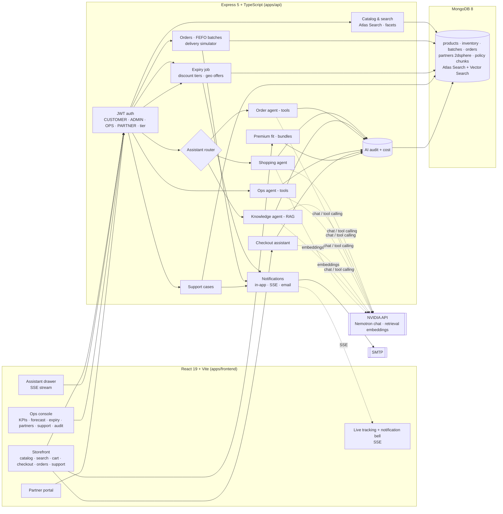
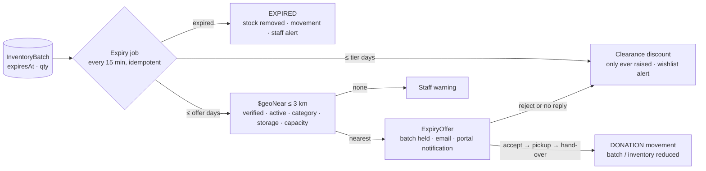

# ShopSmart AI — Architecture

## System overview

Everything AI-related degrades gracefully. With no `NVIDIA_API_KEY`, or when a call fails, each agent falls back to a deterministic path that uses the same data and the same response contract, and the audit log records why. MongoDB features degrade the same way:

| Without | Falls back to |
|---|---|
| Atlas Search | `$text` and regex |
| Vector Search | in-process cosine |
| Replica set | sequential writes with conditional updates |

## Agents

| Agent | Triggered by | Steps | Never does |
|---|---|---|---|
| **Shopping** | "laptop under $1000 for Java and AI", "₹2,000 ke andar jacket" | 1. Intent rules, with LLM extraction sanitised against the catalogue. 2. Hard filters. 3. Keyword rank (Atlas Search) and vector rank, fused with RRF (k=60). 4. Deterministic spec scoring. 5. Explanations, rejected if they cite numbers not in the data. | rank with the LLM |
| **Knowledge** | policy questions | 1. Hybrid retrieval over active, in-force versions. 2. Lexical rerank. 3. Grounded answer from numbered excerpts. 4. Citation and number checks. 5. Confidence from evidence. | answer without a source; LOW confidence offers a support case |
| **Order** | "where is my order", "mera order kab aayega", "can I cancel" | AI SDK tools: `getOrderStatus`, `checkCancellation`, `checkReturn`, `lookupPolicy`, `listMyOrders`. A fixed plan backfills anything the model skipped. | cancel or return; it proposes, the shopper confirms |
| **Checkout** | budget check on `/cart` | 1. Server quote. 2. Cheaper in-stock swaps in the same category. 3. Each swap is re-quoted exactly, including fees, clearance and promotions. 4. A greedy plan prefers the smallest downgrade that fits the budget. | edit the cart |
| **Premium** | product page (Premium tier) | Size from the manufacturer chart, with confidence and "between sizes" notes. Companion products at list prices. | promise a fit or a price it can't support |
| **Ops** | back-office questions | tools: `getStockRisks`, `getFulfillmentIssues`, `suggestPromotions`, `getKpis` | transfer stock or publish a promotion; a human approves |

The router (`src/ai/assistant.ts`) is deterministic so routing is instant and auditable.

## Near-expiry pipeline

Checkout allocates perishables first-expiry-first-out across sellable batches. A clearance discount applies per batch and never stacks with a promotion.

## Data model (Mongoose, `src/models/index.ts`)

| Area | Collections |
|---|---|
| Identity | `users` (role, tier, premiumUntil, region, partner, preferences, measurements, notification prefs) |
| Catalog | `categories` (path), `products` (specs, sizeChart, perishable, storage, embedding), `promotions` |
| Inventory | `warehouses` (GeoJSON), `inventories`, `inventorybatches`, `expiryrules`, `stockmovements` (SALE, RESTOCK, RETURN, TRANSFER, CANCELLATION, EXPIRED, DONATION) |
| Shopping | `carts`, `wishlists`, `orders` (items with batch allocations, embedded shipment and events, returns), `stockrequests` |
| Partners | `partners` (2dsphere), `expiryoffers` (unique batch + partner, history, email status) |
| Messaging | `notifications` (dedupeKey unique), `supportcases` |
| Knowledge | `policydocuments` (version, effective date, region, tiers, status), `policychunks` (text index, embedding) |
| Audit | `aiaudits` (agent, input, params, tool calls, retrieved ids, output, confidence, model, tokens, estimated cost, latency, fallback, human approval), `aifeedbacks`, `adminaudits` |

## Explainability and audit

- Shopping answers expose a score breakdown per criterion and the parsed requirement chips.
- Knowledge answers cite document, section and version.
- Order and ops answers list the tools they called. Proposed actions show the policy section they rely on.
- Every AI response stores a decision with tokens and estimated cost; KPIs show AI cost for the last 24h and by agent.
- Admin actions are recorded in `adminaudits`. These include stock changes, promotions, rule edits and partner verification.

## Security

- Stateless JWT (HS256). Role guards cover staff, admin, partner and premium routes. A lapsed premium membership counts as Basic.
- Responses use RFC 7807 problem details. Every body and query is validated with zod. Errors from helmet and the upload size limit come back in the same format.
- Ownership checks cover orders, support cases, AI decisions and partner offers (a partner sees only its own).
- AI endpoints have a per-minute limit plus a daily limit by tier. Shopper text is passed to models as delimited data. Agent write actions need a confirming REST call.
- Uploads: size limit, type check, checksum dedupe.
