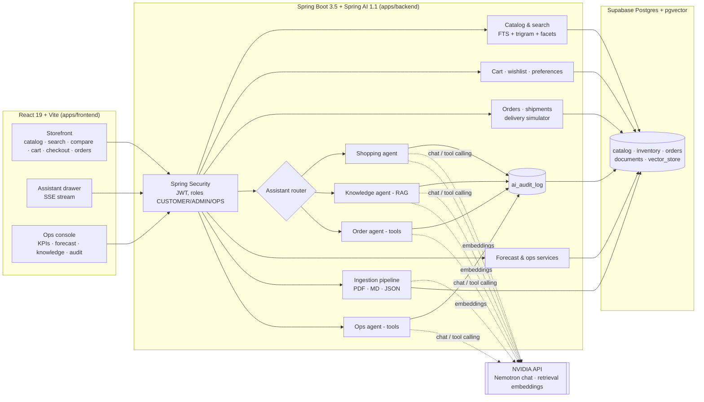
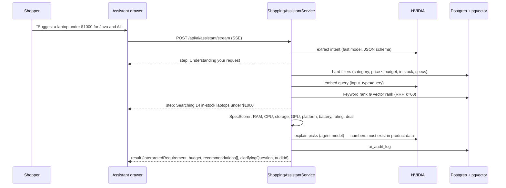
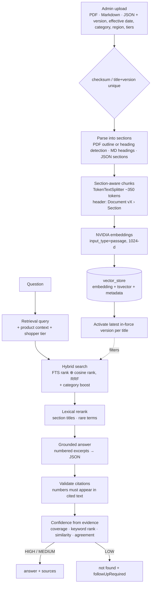

# ShopSmart AI — Architecture

## System overview

Everything AI-related degrades gracefully: with no `NVIDIA_API_KEY` (or when a call fails) each agent falls back to a deterministic path that uses the same data and the same response contract, and the audit log records why.

## Agents

| Agent | Triggered by | Steps | Model use | Never does |
|---|---|---|---|---|
| **Shopping** (Module 1) | "laptop under $1000 for Java and AI" | intent extraction → SQL hard filters → hybrid keyword + vector ranking (RRF) → deterministic spec scoring → explanations | fast model reads the request; agent model writes one-line explanations, rejected if they cite numbers not in the product data | rank products (scores are rule-based and shown in "Why this?") |
| **Knowledge** (Module 2) | return / refund / warranty / delivery / membership questions | hybrid retrieval over active, in-force versions → lexical rerank → grounded answer from numbered excerpts → citation + number checks → evidence-based confidence | agent model answers only from excerpts | answer without a source; LOW confidence returns "not found" + `followUpRequired` |
| **Order** | "where is my order", "can I cancel it", "return it" | Spring AI `@Tool`s: `getOrderStatus`, `checkCancellation`, `checkReturn`, `lookupPolicy`, `listMyOrders` | model chooses tools and phrases the reply; a fixed plan backfills | cancel or return — it proposes; the shopper confirms in the UI |
| **Ops** | back-office questions | tools: `getStockRisks`, `getFulfillmentIssues`, `suggestPromotions`, `getKpis` | model chooses tools and summarises | transfer stock or publish a promotion — a human approves |

The router (`AssistantRouter`) is deterministic so routing is instant and auditable.

## Module 1 — shopping pipeline

## Module 2 — RAG pipeline

## Data model (Flyway `V1__schema.sql`, `V2__orders.sql`)

| Area | Tables |
|---|---|
| Identity | `users` (role, membership_tier, region), `user_preferences` |
| Catalog | `categories` (tree via `path`), `brands`, `products` (`specs` jsonb, `search_tsv`, `embedding vector(1024)`) |
| Inventory | `warehouses`, `inventory` (per product × centre), `stock_movements` (SALE, RESTOCK, RETURN, TRANSFER_IN/OUT, CANCELLATION) |
| Shopping | `carts`, `cart_items`, `wishlists`, `orders`, `order_items`, `shipments`, `shipment_events`, `return_requests` (with the policy it was granted under), `promotions` |
| Knowledge | `documents` (version, effective_date, category, region, applies_to_tiers, status, is_active), `vector_store` (Spring AI layout + `content_tsv`) |
| AI | `ai_audit_log` (agent, input, extracted params, tool calls, retrieved ids, output, confidence, model, tokens, latency, fallback reason, human_approved), `ai_feedback` |

## Explainability and audit

- Shopping answers expose the score breakdown per criterion and the parsed requirement chips.
- Knowledge answers cite document, section and version; the source panel opens the exact section and warns when a version has been superseded.
- Order and ops answers list the tools they called; proposed actions show the rule (policy section) they rely on.
- Every AI response stores a decision row; the admin audit viewer shows inputs, tool steps, retrieved ids, output, model, tokens, latency and any fallback. Approvals of agent-proposed actions set `human_approved`.

## Security

- Stateless JWT (HS256) with roles; admin/ops APIs guarded by URL rules and `@PreAuthorize`.
- RFC 7807 `ProblemDetail` errors everywhere, Jakarta validation on every request body.
- AI endpoints are rate limited per user or IP; shopper text is passed to models as delimited data, and agent write actions require a confirming REST call.
- Uploads: size limit, type check (PDF magic bytes), checksum dedupe.
